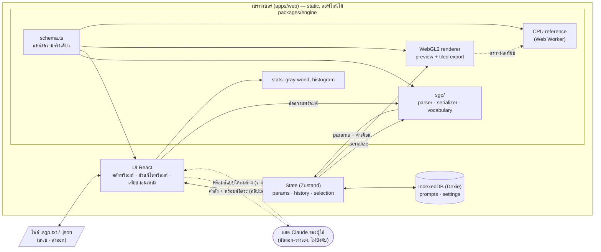

# 01 · Blueprint ระบบภาพรวม: Prompt Grader (เกรดสีจากพร้อมต์)

> เอกสารแม่บทของโปรเจค อ่านไฟล์นี้ก่อนไฟล์อื่นทุกครั้ง เอกสารเฉพาะเรื่องอยู่ในไฟล์ `00`–`15` ของโฟลเดอร์ `docs/`

## 1. ระบบนี้คืออะไร

เว็บแอปปรับโทนสีภาพถ่ายจาก **พร้อมต์แบบโครงสร้าง (Structured Grading Prompt · SGP)** ผู้ใช้เลือกพร้อมต์จากคลัง เขียนเอง หรือแนบไฟล์ `.sgp.txt` ระบบ **อ่านพร้อมต์ในเครื่อง** แปลงเป็นค่าพารามิเตอร์ แล้ว **เครื่องยนต์เกรดสีแบบกำหนดผลแน่นอน (deterministic)** ปรับภาพในเบราว์เซอร์

ระบบเป็นเว็บแบบ static ล้วน **ไม่มีเซิร์ฟเวอร์ ไม่ใช้ API key ไม่มีค่าใช้จ่ายต่อการใช้งาน** และใช้งานออฟไลน์ได้ทั้งหมด

| หลักการ | ความหมายเชิงปฏิบัติ |
|---|---|
| **ภาพต้นฉบับไม่ถูกสร้างใหม่** | เครื่องยนต์แก้เฉพาะค่าสีของพิกเซลที่มีอยู่ ใบหน้า ท่าทาง วัตถุ และองค์ประกอบคงเดิมโดยโครงสร้าง |
| **พร้อมต์อ่านได้ทั้งคนและเครื่อง** | `เงา: ยก ปานกลาง (+30)` — คนอ่านเข้าใจ เครื่องอ่านได้แม่นยำ แก้ด้วยมือได้ แบ่งปันเป็นไฟล์ข้อความได้ |
| **ทุกอย่างอยู่ในเครื่องผู้ใช้** | ภาพ พร้อมต์ และคลัง ไม่ถูกส่งออกไปที่ใด |
| **ผลทำซ้ำได้ 100%** | พร้อมต์เดียวกัน + ภาพเดียวกัน = ผลเดียวกันทุกครั้ง ทุกเครื่อง |
| **พารามิเตอร์มีแหล่งความจริงเดียว** | `parameter schema` ขับ UI, เครื่องยนต์ CPU/GPU, ตัวอ่านพร้อมต์ และการตรวจค่า |

### พร้อมต์เขียนอิสระ (เช่นพร้อมต์ภาษาอังกฤษยาว ๆ) ทำอย่างไร
ปุ่ม **"คัดลอกคำสั่งสำหรับแชต Claude"** สร้างข้อความสำเร็จรูปให้ผู้ใช้วางในแชต Claude ที่ใช้อยู่แล้ว แชตตอบกลับเป็นพร้อมต์แบบโครงสร้าง ผู้ใช้คัดลอกกลับมาวาง — ใช้โควตาแชตตามแพ็กเกจของผู้ใช้ ไม่ต้องมี API key (รายละเอียด `06` ข้อ 7)

## 2. ผู้ใช้และงานหลัก

- **ผู้ใช้หลัก:** ช่างภาพสมัครเล่นถึงกึ่งมืออาชีพ และคนทำงานที่ต้องแต่งภาพกิจกรรมหรือภาพบุคคลโดยไม่ต้องเรียน Lightroom
- **งานหลัก:**
  1. เปิดภาพ → เลือกพร้อมต์ → ได้ภาพสวยภายในไม่กี่วินาที
  2. เขียนหรือแนบพร้อมต์แบบโครงสร้าง → เห็นผลทันทีขณะพิมพ์ → ปรับแถบเลื่อนต่อ → เก็บเข้าคลัง
  3. ใช้พร้อมต์เดียวกันกับภาพหลายภาพให้โทนเป็นชุดเดียวกัน (ระยะต่อยอด)
  4. แบ่งปันพร้อมต์กับเพื่อนร่วมงานเป็นไฟล์ `.sgp.txt` หรือทั้งคลังเป็น `.json`

## 3. สถาปัตยกรรมภาพรวม



### 3.1 ส่วนประกอบหลัก

| ส่วน | ที่อยู่ | หน้าที่ | เทคโนโลยี |
|---|---|---|---|
| Parameter schema | `packages/engine/src/schema.ts` | นิยามพารามิเตอร์ทุกตัว (key, ช่วง, ค่าเป็นกลาง, ป้ายภาษาไทย) | TypeScript + zod |
| SGP | `packages/engine/src/sgp/` | อ่าน/เขียนพร้อมต์แบบโครงสร้าง, คำศัพท์จาก `seed/sgp-vocabulary.json` | TypeScript (pure) |
| CPU engine | `packages/engine/src/cpu/` | การคำนวณอ้างอิงสำหรับ test และ fallback เมื่อไม่มี WebGL2 | TypeScript, Web Worker |
| GPU engine | `packages/engine/src/gl/` | พรีวิวเรียลไทม์และส่งออกความละเอียดเต็มแบบแบ่งไทล์ | WebGL2 + GLSL ES 3.0 |
| Web app | `apps/web/` | UI, state, คลังพร้อมต์, แนบ/ส่งออกไฟล์, PWA | Vite, React 18, Zustand, Dexie |
| Seed data | `seed/` | schema, คำศัพท์ SGP, คำสั่งสำหรับแชต, พรีเซ็ตตั้งต้น | JSON, ข้อความ |
| ต้นแบบ | `reference/` | ต้นแบบเครื่องยนต์ (`prototype-v3.html`) และตัวอ่าน SGP อ้างอิง (`sgp-reference.mjs` + test) | HTML, JS |

### 3.2 ลำดับการไหลของข้อมูลหลัก

**A. ใช้พรีเซ็ตกับภาพ**
1. เปิดภาพ → ถอดรหัส (`createImageBitmap`, เคารพ EXIF orientation) → คำนวณสถิติภาพใน Worker
2. เลือกพรีเซ็ต → `params` เข้า store → GPU renderer วาดพรีวิว (≤ 2048 px ด้านยาว)
3. ปรับแถบเลื่อน → re-render ทุกเฟรม (เป้าหมาย ≥ 30 fps)

**B. เขียน/แนบพร้อมต์แบบโครงสร้าง**
1. พิมพ์ในตัวแก้ไข หรือแนบ `.sgp.txt` หรือวางคำตอบจากแชต
2. ตัวอ่าน SGP ทำงานทุกครั้งที่หยุดพิมพ์ 150 ms → ได้ `{params, name, tags, notes, warnings}`
3. พรีวิวเปลี่ยนทันที; คำเตือนแสดงที่เลขบรรทัด; หัวข้อที่สะกดผิดมีคำแนะนำ
4. ปรับแถบเลื่อนต่อได้ — ข้อความพร้อมต์ถูกเขียนใหม่ด้วย serializer ให้ตรงกับแถบเลื่อนเสมอ (ยกเว้นส่วนหมายเหตุ)
5. บันทึกเข้าคลัง

**C. ส่งออกความละเอียดเต็ม**
1. GPU แบ่งภาพเป็นไทล์ (≤ 4096 px + ขอบซ้อน 2 px สำหรับ detail pass) → รวมลง canvas ขนาดจริง → encode JPEG/PNG/WebP
2. ไม่มี WebGL2 หรือหน่วยความจำ GPU ไม่พอ → CPU engine ใน Worker แบบแบ่งแถบ

## 4. เครื่องยนต์เกรดสี (สรุป)

ลำดับขั้นของ pipeline ต่อพิกเซล รายละเอียดสูตรอยู่ใน `docs/04-grading-engine-spec.md`

```
0. detail pass (3×3)   : denoise แบบรักษาขอบ + unsharp mask   [ต้องดูพิกเซลข้างเคียง]
1. exposure + WB       : 2^EV, temp/tint, gray-world cast fix
2. dehaze              : ลบ airlight คงที่
3. HSV stage           : HSL 6 แถบสี, logic ใบไม้ (teal/forest/sun), saturation-in-HSV, vibrance
4. global saturation   : ผสมกับ luminance (ขาวดำถูกต้อง)
5. tone on luminance   : highlights, shadows, contrast S-curve (รักษา hue)
6. split toning        : สีในเงา/ไฮไลต์ตาม hue
7. yellow guard        : ลดสีเหลือง/อำพันเกินในโทนกลาง-สว่าง
8. haze (spatial)      : หมอกไล่จากขอบบน ปรับโทนเย็น/อุ่น
9. fade, vignette, grain
10. mix                : ผสมกับต้นฉบับตาม amount
```

**ข้อกำหนดที่ห้ามละเมิด (invariants):**
- ค่าเป็นกลางทั้งหมด → ผลลัพธ์เท่ากับต้นฉบับทุกพิกเซล (identity)
- `amount = 0` → ต้นฉบับ
- ขนาดภาพ อัตราส่วน และตำแหน่งพิกเซลไม่เปลี่ยน
- GPU กับ CPU ต่างกันไม่เกิน 2/255 ต่อช่องสีสำหรับพรีเซ็ตในตัว รวม grain เพราะทั้งสองฝั่งใช้ integer hash ตัวเดียวกัน (รายละเอียด `04` ข้อ 3)
- **SGP round-trip:** `parse(serialize(p)).params === p` ทุกพรีเซ็ต

## 5. ข้อมูลและการจัดเก็บ (สรุป)

- **พร้อมต์ (Prompt):** `{id, name, prompt (ข้อความ SGP), params, notes, preserve, tags[], source, schemaVersion, createdAt, updatedAt}`
- เก็บใน IndexedDB (local-first) แบ่งปันด้วยไฟล์ `.sgp.txt` (พร้อมต์เดียว) หรือ `.json` (ทั้งคลัง)
- รายละเอียด: `07-data-model-storage.md`, `09-file-formats.md`

## 6. ความปลอดภัยและความเป็นส่วนตัว (สรุป)

- ไม่มีเซิร์ฟเวอร์ ไม่มีความลับให้รั่ว ไม่มีการส่งภาพหรือข้อความออกจากเครื่อง
- ไฟล์ที่แนบและข้อความที่วางเป็นข้อมูลไม่น่าเชื่อถือ: ผ่านตัวอ่าน SGP ที่ให้ผลได้เพียงตัวเลขในช่วงที่อนุญาต, จำกัดขนาด, แสดงข้อความด้วย text เท่านั้น
- รายละเอียด: `11-security-privacy.md`

## 7. ระยะการพัฒนา

| ระยะ | ผลลัพธ์ | เกณฑ์ผ่าน |
|---|---|---|
| P0 ตั้งต้น | monorepo, lint, test, CI | `pnpm test` ผ่านบน CI |
| P1 เครื่องยนต์ CPU | พอร์ตจากต้นแบบ + schema + golden tests | identity test และ golden images ผ่าน |
| P2 เครื่องยนต์ GPU | WebGL2 parity กับ CPU | parity ≤ 2/255, พรีวิว ≥ 30 fps |
| P3 ตัวแก้ไขภาพ | UI แถบเลื่อน, เทียบก่อน/หลัง, histogram, undo/redo | e2e เปิดภาพ-ปรับ-เห็นผล |
| P4 คลังพร้อมต์ | CRUD, พรีเซ็ตในตัว, นำเข้า/ส่งออก JSON | ข้อมูลอยู่รอดหลังรีโหลด |
| P5 พร้อมต์แบบโครงสร้าง | ตัวอ่าน/ตัวเขียน SGP, ตัวแก้ไขพร้อมต์, แนบไฟล์, คำสั่งสำหรับแชต | test ของ `reference/sgp-reference.test.mjs` ผ่านบน port + round-trip ทุกพรีเซ็ต |
| P6 ส่งออกภาพ | ไทล์ความละเอียดเต็ม, JPEG/PNG/WebP | ภาพ 48 MP ส่งออกได้, ขนาดตรงต้นฉบับ |
| P7 PWA + ขัดเกลา | ออฟไลน์เต็มรูปแบบ, a11y, ธีมมืด, มือถือ | Lighthouse a11y ≥ 95 |
| P8 Deploy | โฮสต์ static | smoke test บน production |
| ต่อยอด | batch, LUT .cube, mask เฉพาะจุด, ซิงก์คลาวด์, (ทางเลือก) แปลงพร้อมต์อิสระผ่าน API | ดู `13-roadmap.md` |

## 8. แผนที่เอกสาร

| ไฟล์ | เนื้อหา |
|---|---|
| `00-folder-structure.md` | โครงสร้างโฟลเดอร์ |
| `02-requirements.md` | ความต้องการเชิงหน้าที่และไม่ใช่หน้าที่ |
| `03-architecture.md` | สถาปัตยกรรมเชิงลึก โมดูล อินเทอร์เฟซ |
| `04-grading-engine-spec.md` | สูตรคณิตศาสตร์ทุกขั้นของ pipeline |
| `05-parameter-schema.md` | ตารางพารามิเตอร์ทั้งหมด + กติกาการเพิ่ม |
| `06-structured-prompt-format.md` | **รูปแบบพร้อมต์แบบโครงสร้าง**, คำศัพท์, กติกาการอ่าน, คำสั่งสำหรับแชต |
| `07-data-model-storage.md` | โมเดลข้อมูล IndexedDB, migration |
| `08-ui-ux-spec.md` | หน้าจอ, ส่วนประกอบ, ข้อความ UI ภาษาไทย, การเข้าถึง |
| `09-file-formats.md` | ไฟล์ `.sgp.txt`, `.json`, การแนบ และคลิปบอร์ด |
| `10-testing-strategy.md` | unit, SGP, golden image, parity, e2e |
| `11-security-privacy.md` | ความปลอดภัยและความเป็นส่วนตัว |
| `12-deployment.md` | การ build และโฮสต์ static |
| `13-roadmap.md` | งานต่อยอดหลัง MVP |
| `14-presets-catalog.md` | แคตตาล็อกพรีเซ็ตตั้งต้น (พร้อมต์ต้นฉบับ + แบบโครงสร้าง) |
| `15-claude-code-playbook.md` | ลำดับคำสั่งสำหรับสั่ง Claude Code สร้างโปรเจคทีละระยะ |
| `adr/` | บันทึกการตัดสินใจเชิงสถาปัตยกรรม |
